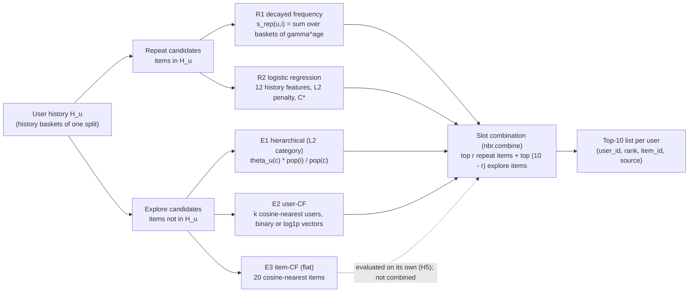

# Architecture

System structure, profiles, commands, selection procedure and leakage rules of the `nbr`
package (hierarchical next-basket recommendation, ML Team 9). Source of truth for the
hypotheses and the selection rules is `docs/PREREG.md`; this document describes how the
code implements them. Module and combination codes (E1-E8, R1-R6, C0-C4, C3b) are defined
in `docs/MODULES.md`; result numbers live in `reports/results/RESULTS.md` and are not repeated here.

## 1. System structure

Every recommendation list is built from one user's purchase history only. The task is split
into a **repeat branch** (items the user has bought before) and an **explore branch** (items
the user has never bought); the two ranked lists are merged by a fixed slot rule into a
Top-10 list.



The final system of PREREG v1.3 is C3 = R2 + E2 (confirmed on `holdout2`, `reports/final2/RUN.md`); the
v1.2 final list C0 = R1 + E1 is its comparator in H7'. A step-by-step diagram of the final system is
`docs/figures/nbr_architecture_final.png` (Mermaid source `docs/figures/nbr_architecture_final.mmd`).

Components and where they live:

| Stage | What it computes | Code |
|---|---|---|
| Data | history/target frames per split, category levels L1-L3 attached from `items.parquet`, target split into repeat/new rows | `src/nbr/data.py` (`load_split`, `attach_levels`, `split_target`), `src/nbr/pipeline.py:prepare` |
| Popularity | `pop(i)` = number of history baskets containing `i` (per split, all users) | `src/nbr/baselines.py:item_popularity` |
| Repeat branch R1 | `s_rep(u,i) = sum_b gamma^age(b)`, age 0 = most recent basket; `gamma = 1` is personal purchase frequency (R5) | `src/nbr/repeat.py` (`basket_ages`, `repeat_scores`, `repeat_list`) |
| Repeat branch R2 | 12 features per (user, item) pair of the history; StandardScaler + L2 logistic regression; score = decision function | `src/nbr/features.py`, `src/nbr/lr_repeat.py` |
| Repeat branch R3 (screening only) | R2 features + binned purchase-cycle features (30 features) | `src/nbr/features_cycle.py`, `src/nbr/r3_eval.py` (stand-alone screening runner) |
| Explore branch E1 | category profile `theta_u(c) = (sum_b gamma_c^age(b) n_b(c) + alpha p(c)) / (sum_b gamma_c^age(b) n_b + alpha)`; item score `theta_u(c) * pop(i) / pop(c)` over unbought items; exact top-k by category pruning | `src/nbr/explore.py` (`category_profile`, `explore_list`, `category_ranking`) |
| Explore branch E2 | user x item vectors (binary or log1p basket counts), cosine neighbours, `score(u,i) = sum_v sim(u,v) x_{v,i}` over unseen items, padded with popularity | `src/nbr/usercf.py` (`user_vectors`, `user_neighbors`, `ucf_list`) |
| Explore branch E3 / E4 | item cosine neighbours from the binary user x item matrix; flat item-CF list (E3) and the within-category variant `theta_u(c) * cf(u,i) / sum cf` (E4) | `src/nbr/itemcf.py`, `src/nbr/explore.py:explore_list_cf` |
| Baselines | global popularity (with and without the user's history items), personal frequency padded with popularity | `src/nbr/baselines.py` |
| Combination | first `r` slots from the repeat list, the rest from the explore list, leftover repeat items fill up; no duplicates; `r = 10` gives the repeat-only list | `src/nbr/combine.py:combine` |
| Metrics | per-user Recall@10, NDCG@10 (binary relevance), category hit@10; paired bootstrap over users | `src/nbr/metrics.py` |
| Orchestration | fit-split selection (`tune`), eval-split evaluation (`evaluate`), JSON output with provenance | `src/nbr/pipeline.py`, `src/nbr/io.py`, `src/nbr/__main__.py` |

Tie rule shared by every list: score desc, then `pop` desc, then `item_id` asc (`nbr.repeat.rank_scores`).
List frames always have the columns `user_id, rank, item_id, source`; `source` records which
branch produced the item (`repeat`, `repeat_lr`, `explore`, `usercf`, `itemcf`, `explore_cf`, `popularity`).

## 2. Profiles and their roles

| Profile | Config | Role | Data | Use |
|---|---|---|---|---|
| `sample` | `configs/sample.yaml` (`role: smoke`) | smoke test | Instacart 1,500 users; Complete Journey sample | pipeline checks only; no reported results |
| `medium` | `configs/medium.yaml` (`role: development`) | development | Instacart 20,000 users; Complete Journey 2,069 households (eval split already used in earlier ML_group9 experiments) | all development runs (W4a, W6-W9); not confirmatory |
| `holdout` | `configs/holdout.yaml` (`role: final`, `complete_journey_profile: medium`) | confirmatory, PREREG v1.2 | Instacart 20,000 users disjoint from `sample` and `medium` (`data/SOURCE.md`); Complete Journey reuses the `medium` data (refit; limitation recorded in PREREG v1.2) | read exactly once for H1-H5 (`reports/final/RUN.md`) |
| `holdout2` | `configs/holdout2.yaml` (`role: final`, `complete_journey_profile: medium`) | confirmatory, PREREG v1.3 | Instacart 20,000 users disjoint from `sample`, `medium` and `holdout` (`data/SOURCE.md`; built on 2026-11-06 after the v1.3 amendment was committed); Complete Journey reuses the `medium` data (refit, not independent of development) | read exactly once for H6, H7', H8 and the secondary analyses, in command 2 of `reports/final2/RUN.md` |

Category levels (`configs/common.yaml`): Instacart department (L1) -> aisle (L2) -> ingredient
type (L3, aisle fallback); Complete Journey DEPARTMENT (L1) -> commodity (L2) -> sub-commodity (L3).
The explore branch uses L2 (`explore.level`); `explore_L3` is an ablation list.

## 3. Commands, inputs and outputs

All commands run from the repository root with `PYTHONPATH=src` (or after `pip install -e .`).
The processed-data root is `configs/common.yaml:data_dir` (`data/processed`) or the environment
variable `NBR_DATA_DIR`, which wins when set (used by the git worktrees, which share one
processed-data folder).

| Command | Reads | Writes |
|---|---|---|
| `python scripts/make_holdout.py --raw-dir <ML_group9/data/raw> [--name holdout] [--exclude medium,sample] [--size 20000] [--seed 42] [--expect-remaining N]` | raw Instacart archive, `vendor/ml_group9_e11b365` preprocessing code, `<data_dir>/{medium,sample}/instacart/eval_target.parquet` (user ids of the excluded profiles; a profile with a selection report, such as `holdout`, is reconstructed from its seeded draw instead of being read) | `<data_dir>/<name>/instacart/*.parquet`, `reports/holdout_prep/<name>_selection.json` (`holdout2`: `--name holdout2 --exclude sample,medium,holdout`) |
| `python scripts/check_data.py <profile>` | `data/processed/<profile>/<dataset>/{items,fit_history,fit_target,eval_history,eval_target}.parquet` | `reports/data_check/<profile>.json` |
| `python -m nbr check --profile P` | fit and eval splits of every dataset of the profile (holdout eval skipped by the guard) | stdout only |
| `python -m nbr tune --profile P --dataset D` | `fit_history`, `fit_target`, `items` | `reports/metrics/P_D_tuning.json` (stage 1-3 grids and selections, LR C selection, user-CF and slot selections), `artifacts/P/D_lr_repeat.joblib` |
| `python -m nbr evaluate --profile P --dataset D [--transfer-from instacart] [--final] [--no-itemcf] [--no-lr] [--no-integration] [--skip-l3]` | `eval_history`, `eval_target`, `items`, the tuning JSON and the joblib bundle of `D` (or of `--transfer-from`) | `reports/metrics/P_D_eval.json` (or `P_D_eval_transfer.json`): list metrics, H1-H5 primary comparisons, secondary comparisons, history-length breakdown, `lr_repeat` block (H6, H7), `integration` block (H8, H9 and the C3-vs-C0 comparisons of H7', with decision wording) |
| `python -m nbr.usercf_eval --profile {sample,medium} --dataset D --stage {tune,evaluate,all}` | fit/eval splits; base selections (gamma, gamma_c, alpha, r) from `reports/metrics/P_D_tuning.json` of this repository (override: `NBR_TUNING_DIR` or `--tuning-dir`) | `reports/metrics/P_D_usercf_tuning.json`, `P_D_usercf_eval.json` (W7 stand-alone H8 run; refuses holdout paths) |
| `python -m nbr.r3_eval --profile {sample,medium} --dataset D [--gamma-dir DIR] [--r3-config FILE]` | fit/eval splits; gamma* from `reports/metrics/P_D_tuning.json` (override: `NBR_TUNING_DIR` or `--gamma-dir`); `configs/r3.yaml` | `reports/metrics/P_D_r3.json`, `reports/tables/P_D_r3_{coefficients,overdue_coef}.csv`, `reports/figures/P_D_r3_overdue_coef.png`, `artifacts/P/D_r3.joblib` (refuses `role: final`) |
| `python scripts/make_results.py [--verify]` | final JSONs (`reports/final/`, `reports/final2/`) and the development JSONs of the sibling worktrees listed in `scripts/results_sources.yaml` (`NBR_WORKTREES`) | `reports/results/{tables,figures}/T1-T7, F1-F7`, `reports/results/RESULTS.md` |
| `python scripts/check_readme_results.py [--render]` | `reports/results/tables/T1_master_hypotheses.csv`, `README.md` | stdout: the README result tables rendered from T1 (`--render`) or the cell-by-cell comparison with the README (exit 1 on a mismatch) |
| `python scripts/audit_code.py [--extra BRANCH:PATH]` | `src/nbr/*.py`, `scripts/*.py` (static ast audit) | `docs/CODE_AUDIT.md` |
| `python -m pytest` | `tests/` (synthetic data; no processed data needed) | - |

Every JSON written by `nbr.io.write_json` carries a `meta` block (`git_commit`, UTC time, profile,
Python/numpy/pandas versions). The final JSONs are copied to `reports/final/` (v1.2) and `reports/final2/`
(v1.3) with `SHA256SUMS` (`reports/final/RUN.md`, `reports/final2/RUN.md`). `reports/metrics/`, `reports/figures/`, `reports/tables/`,
`artifacts/` and `data/processed/` are not tracked by git.

Evaluation flags: `--final` is the only way to read the Instacart eval split of a `role: final`
profile; `--no-itemcf` skips E3/E4 and H5; `--no-lr` skips R2 (H6, H7); `--no-integration` skips
E2 and the combinations (H8, H9); `--skip-l3` skips the `explore_L3` ablation (used in the W8b run).

## 4. Selection procedure (fit split only)

All selections use the fit split of the same profile and dataset. The eval split is never read
during `tune`. Ties are judged with `math.isclose(rel_tol=1e-12)`.

| Step | Parameter | Grid (`configs/common.yaml`, `configs/usercf.yaml`) | Criterion | Tie rule | Code |
|---|---|---|---|---|---|
| 1 | `gamma` (R1 decay) | {0.5, 0.6, 0.7, 0.8, 0.9, 1.0} | repeat-component Recall@10 on users with >= 1 repeat target item | gamma closest to 1 | `pipeline.select_gamma` |
| 2 | `(gamma_c, alpha)` (E1 profile) | {0.8, 0.9, 1.0} x {1, 10, 100} | new-item Recall@10 on users with >= 1 new target item | larger alpha, then larger gamma_c | `pipeline.select_explore` |
| 3 | `r` (slots of C0) | {5, ..., 10} | NDCG@10 of `combine(repeat_star, explore_star, r)` over all fit users | larger r | `pipeline.select_r` |
| LR | `C` (R2 inverse regularisation) | {0.001, 0.01, 0.1, 1, 10} | repeat Recall@10 of the top-10 scored pairs on validation users (20 % of fit users, `numpy.random.default_rng(42).permutation`), model fitted on the remaining 80 %; then refit on all fit rows at C* | smaller C | `lr_repeat.fit_select`, `lr_repeat.select_c` |
| user-CF | `(k, weighting)` (E2) | {10, 20, 50, 100, 200, 400} x {binary, log1p} (k = 10 added by PREREG v1.3) | new-item Recall@10 on the fit split (neighbours computed once per weighting with max k, truncated per k) | smaller k, then binary | `usercf_eval.tune_history`, `usercf_eval.select_parameters` |
| slots | `r` of C2, C3, C3b | {0, ..., 10} | NDCG@10 of the combination; for combinations with R2 (C2, C3) scored on the LR validation users with the model fitted on the LR training users only; for C3b on all fit users | larger r | `pipeline.tune_integration` |

The selected values, every grid point's score and an `at_grid_edge` flag are written to the tuning
JSON. `evaluate` reads them back (`load_selections`, `load_integration_selections`) and never
re-optimises anything on the eval split. The Complete Journey transfer run applies the Instacart
selections (`--transfer-from instacart`).

Inference on the eval split: paired bootstrap over users (`metrics.paired_bootstrap`; 1,000
resamples, seed 42) of `mean(model) - mean(comparator)`; percentile CIs at 95 % and 99.375 %
(Bonferroni over the 8 primary tests of PREREG v1.2; PREREG v1.3 uses the same 99.375 % interval as the
multiplicity-adjusted interval of its family of 3: H6, H7', H8). Decision wording (`pipeline.decision`):
lower bound > 0 -> "improvement observed"; CI contains 0 -> "no difference established";
upper bound < 0 -> "lower". Secondary comparisons carry CIs without a decision, except the two C3-vs-C0
entries (`integration.secondary.final_lr_ucf_vs_final_ndcg` / `_recall`, H7'), which carry the decision
wording (reporting-only change committed before the v1.3 run).

## 5. Leakage prevention and holdout protection

- **History-only lists.** Every list builder (`repeat_list`, `explore_list`, `ucf_list`,
  `cf_list`, `popularity_list`, `combine`) receives history frames only; targets are passed to the
  metric functions alone. `pop(i)`, `p(c)`, item neighbours and user neighbours are recomputed from
  the history of the split being evaluated.
- **Features from history only.** `features.repeat_features` and `features_cycle.cycle_features`
  read the history frame only; the fit target defines the training label `y` and nothing else
  (`lr_repeat.build_training`; checked by `tests/test_features.py` and `tests/test_features_cycle.py`).
- **User-level validation.** `C` is chosen on a disjoint set of validation users; the slot `r` of
  LR combinations is chosen on the same validation users with a model fitted on the training users
  only (`lr_repeat.train_only_bundle`), so no row's label influences its own ranking during selection.
- **Holdout guard.** `data.load_split` raises `PermissionError` for the Instacart eval split of a
  `role: final` profile unless `allow_holdout_eval=True`, which only the CLI flag `--final` sets.
  `nbr check` reports such splits as skipped. `usercf_eval` refuses `role: final` profiles and any
  data path containing "holdout"; `r3_eval` refuses `role: final`.
- **Single read, recorded.** The run order, timestamps, exit codes and the statement that the
  Instacart eval split was read exactly once are in `reports/final/RUN.md` (holdout, PREREG v1.2, tag
  `prereg-v1.2`) and `reports/final2/RUN.md` (holdout2, PREREG v1.3, tag `prereg-v1.3`; the guard check
  and the commit of the selections before command 2 are recorded there); the final JSONs and their
  SHA-256 digests are in `reports/final/` and `reports/final2/`.
- **Development vs confirmatory.** Every JSON carries `label` = `"<role> (<profile>)"`
  (e.g. `development (medium)`); result tables (`reports/results/`) keep the stage column
  `confirmatory holdout2` / `confirmatory holdout` / `development medium` separate, and the T1 columns
  `prereg` / `tier` carry the pre-registered classification of every row.
- **Provenance.** `meta.git_commit` in every JSON; `sha256` of each joblib artifact in the tuning
  and eval JSONs; `data/MANIFEST.sha256` for the processed Parquet files.
- **Team rules outside the code.** The `holdout2` data folder was created (W10a, 2026-11-06) only after
  the PREREG v1.3 amendment was committed, and its Instacart eval split was read once, in command 2 of
  `reports/final2/RUN.md`; development runs use `sample`/`medium` only.

## 6. Repository layout

```
configs/        common.yaml (grids, bootstrap, levels), sample/medium/holdout/holdout2.yaml (profile roles), usercf.yaml (user-CF grid; k = 10 added in v1.3)
data/           SOURCE.md, MANIFEST.sha256 (processed Parquet is not tracked)
docs/           PREREG.md (pre-registration), ARCHITECTURE.md, MODULES.md, LIBRARIES.md, CITATIONS.md, CODE_AUDIT.md, figures/ (final-system diagram)
reports/        final/ (holdout, v1.2) and final2/ (holdout2, v1.3): JSONs + RUN.md + SHA256SUMS (+ logs); results/, data_check/, holdout_prep/; metrics/, figures/, tables/ are untracked
scripts/        make_holdout.py, check_data.py, make_eda.py, make_results.py (+ results_sources.yaml), check_readme_results.py, audit_code.py
src/nbr/        package (see section 1)
tests/          pytest suite on synthetic data
vendor/         ml_group9_e11b365: unmodified preprocessing snapshot (release/term-project e11b365)
```
